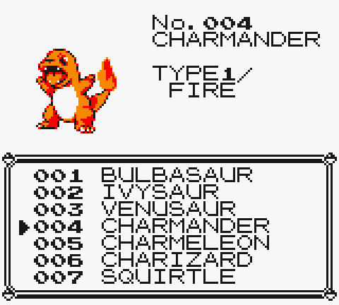
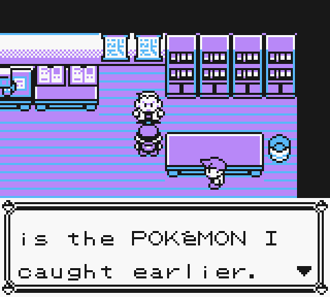
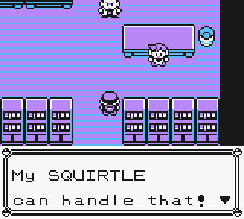

# Pokémon Yellow Legacy: Player Guide

This guide covers this fork of Pokémon Yellow Legacy: how to get the game, the three game modes, and how Pick Starter mode and your rival work. The PDF version is [player_guide.pdf](player_guide.pdf), built from this file by `tools/make_guide.py`.

## Getting the game

Each release is a patch. Apply it to your own copy of the original English Pokémon Yellow ROM; the ROM itself isn't included.

1. Get a **clean** English *Pokémon Yellow Version* ROM (.gb or .gbc). It must not be modified: no randomizer, no other hack, no earlier Yellow Legacy version. Its SHA-1 must be `cc7d03262ebfaf2f06772c1a480c7d9d5f4a38e1`.
2. Download the patch zip from the Releases page and take the `.bps` file out of it.
3. Apply the `.bps` to the ROM with a patcher such as ROM Patcher JS (https://www.marcrobledo.com/RomPatcher.js/, works in any browser, including on phones).
4. Check the patched ROM's SHA-1 against the release notes. If it doesn't match, start again from a clean ROM. Never patch an already patched ROM.
5. Load the result in your emulator (for example mGBA on PC, Delta on iPhone).

Moving from an older Yellow Legacy version: save in a Pokémon Center and back up your save first. Emulators find the save by the ROM's file name, so rename your old `.sav` to match the new ROM if the name changed. Normal, Hard and Pick Starter saves keep working.

The full steps are in [patching_instructions.md](patching_instructions.md). To build the game from source instead, see [INSTALL.md](../INSTALL.md).

## Game modes

When you start a new game, the game asks you to **Select game mode**. The mode can't be changed later.

| Mode | What it is |
|---|---|
| **Normal** | Classic Pokémon rules. Professor Oak gives you Pikachu. |
| **Hard** | Pikachu, with tougher rules: battle style always SET, no items in trainer battles, and level caps by badge count. |
| **Pick Starter** | Normal rules, but you choose any of the 151 Pokémon as your starter. |

Hard mode's level caps (until you enter the Hall of Fame):

| Badges | 0 | 1 | 2 | 3 | 4 | 5 | 6 | 7 | 8 |
|---|---|---|---|---|---|---|---|---|---|
| Cap | 12 | 21 | 24 | 35 | 43 | 50 | 53 | 55 | 65 |

Your own Pokémon above the cap may disobey, gain no experience and can't use Rare Candy. The full rules are in [hard_mode.md](hard_mode.md).

## Pick Starter: choosing your Pokémon

1. Choose **NEW GAME**, then **PICK STARTER**, and confirm.
2. Straight away, the game tells you that Professor Oak will catch a Pokémon for you and opens a list of all 151 Pokémon.
3. Choose one (the controls are below). The game asks "So, you want …?"; answer **YES** to take it or **NO** to keep looking. You can't leave without choosing.
4. The intro goes on as usual: boy or girl, Oak's speech, your name and your rival's name.
5. When you head for Route 1, Oak stops you in the tall grass and catches the Pokémon you picked.
6. In Oak's lab, take the Poké Ball on his table. Oak gives you the Pokémon he caught earlier.

| Button | In the list |
|---|---|
| UP / DOWN | Move one entry (hold to scroll; the list wraps around) |
| LEFT / RIGHT | Move a page |
| SELECT | Show the Pokémon's types, base stats or level-5 moves |
| A | Choose it |

The picture of the highlighted Pokémon appears once you stop scrolling.

## Pick Starter: the rules

- Everything except the starter follows Normal rules: battle style SHIFT is allowed, items work in battle and there are no level caps.
- Your starter is a normal level-5 Pokémon of its species with its usual level-5 moves. It levels up and evolves as usual.
- **Pikachu** gives you the classic Yellow experience: it follows you, has happiness and gets every Pikachu scene, exactly as in Normal mode.
- **Any other Pokémon:**
  - Nothing follows you, and the Pikachu-only scenes are skipped.
  - Melanie in Cerulean City still gives you Bulbasaur, and Charmander (Route 24) and Squirtle (Officer Jenny, Vermilion City) are available as usual.
  - Any Pokémon in your party that knows Surf can play Pikachu's Beach in the Summer Beach House on Route 19.
- **Pokémon that can't attack yet.** Abra, Kadabra, Alakazam, Magikarp, Ditto, Ekans, Arbok, Cubone, Marowak, Clefable, Mr. Mime and Snorlax know no damaging move at level 5. The game warns you before you take one. They're a challenge: you'll likely lose the first rival battle (the story goes on anyway), and you can run from wild Pokémon until you can buy Poké Balls in Viridian City. Ditto copies its opponent's moves, so it can fight from the start.
- **Legendaries and Mew** can be picked too. They start at level 5 like everything else.

## Your rival

Your rival takes his Eevee before you take your Pokémon. Once he sees yours, he picks a Pokémon that beats it, and keeps that Pokémon's line for every rival battle.

- **Pikachu:** he keeps his Eevee, exactly as in Normal mode.
- **Bulbasaur, Charmander or Squirtle line:** the starter that beats it, as in Red and Blue. Charmander against the Bulbasaur line, Squirtle against the Charmander line, Bulbasaur against the Squirtle line.
- **Anything else:** the Pokémon from his list whose type hits yours hardest. On a tie he takes the one your Pokémon hits least.

Before your first battle he comments on your choice. An Eevee like his ("Copycat!"), a legendary, or a Pokémon that can't attack yet gets its own remark. Then he says what he wants instead, and swaps his Eevee.

His Pokémon evolves as you'd expect: Machop becomes Machoke at Lv28 and Machamp at Lv38, Geodude Graveler at Lv25 and Golem at Lv38, Magnemite Magneton at Lv30, Drowzee Hypno at Lv26, Gastly Haunter at Lv25 and Gengar at Lv42, Clefairy Clefable from Lv30, and the starters at their usual levels. His other Pokémon come from his usual Legacy teams.

<!-- guide: rival counter summary -->
The rival's Pokémon for every pick is listed in [pick_starter_mode.md](pick_starter_mode.md#the-rivals-counter).

## Saves

- The mode is stored in your save. Normal and Hard saves from earlier versions load and play unchanged.
- A Pick Starter save made in an earlier version, before getting a starter, opens the list in Oak's lab instead of the intro.
- Don't load a Pick Starter save into a version from before Pick Starter mode existed: it would play with Hard rules.
